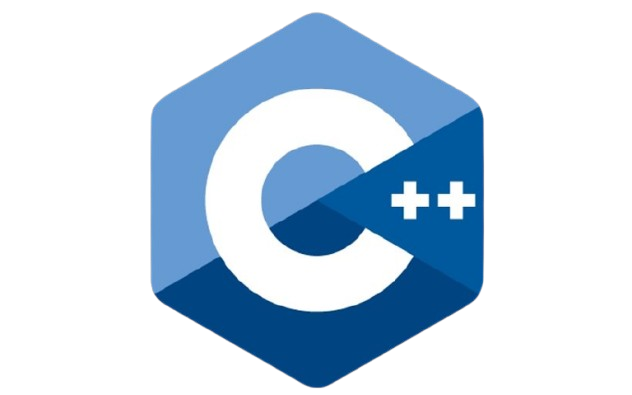
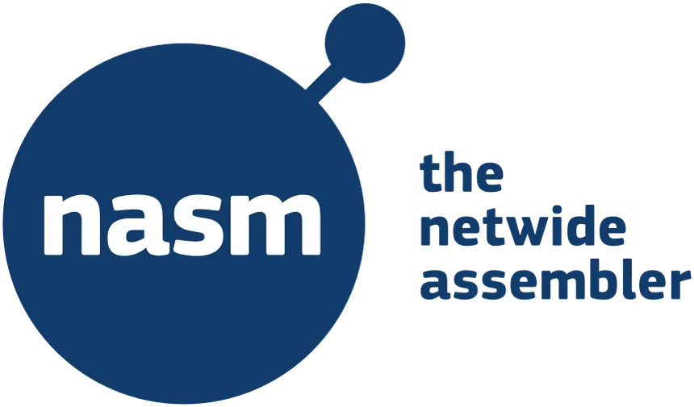
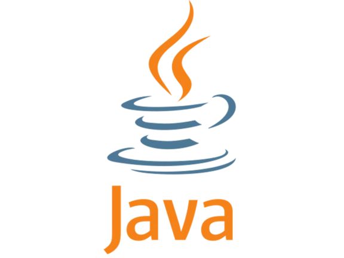
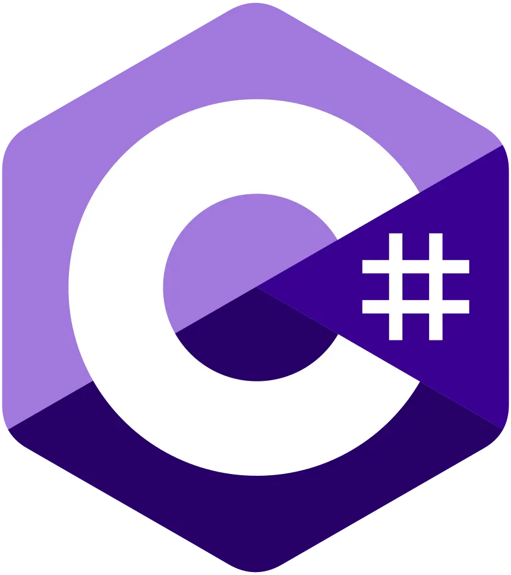

# Hello World!

```
 /$$             /$$                                   /$$             /$$$ /$$$           /$$$                                              
|__/            | $$                                  |__/            /$$_/|_  $$         /$$_/                                              
 /$$ /$$$$$$$  /$$$$$$         /$$$$$$/$$$$   /$$$$$$  /$$ /$$$$$$$  /$$/    \  $$       | $$                                                
| $$| $$__  $$|_  $$_/        | $$_  $$_  $$ |____  $$| $$| $$__  $$| $$      | $$       /$$$                                                
| $$| $$  \ $$  | $$          | $$ \ $$ \ $$  /$$$$$$$| $$| $$  \ $$| $$      | $$      |  $$                                                
| $$| $$  | $$  | $$ /$$      | $$ | $$ | $$ /$$__  $$| $$| $$  | $$|  $$     /$$/       \ $$                                                
| $$| $$  | $$  |  $$$$/      | $$ | $$ | $$|  $$$$$$$| $$| $$  | $$ \  $$$ /$$$/        |  $$$                                              
|__/|__/  |__/   \___/        |__/ |__/ |__/ \_______/|__/|__/  |__/  \___/|___/          \___/                                              
                                                                                                                                             
                                                                                                                                             
                                                                                                                                             
                                             /$$             /$$      /$$$$$$   /$$$ /$$ /$$ /$$   /$$                     /$$ /$$ /$$$      
                                            |__/            | $$     /$$__  $$ /$$_/| $$| $$| $$  | $$                    | $$| $$|_  $$     
                          /$$$$$$   /$$$$$$  /$$ /$$$$$$$  /$$$$$$  | $$  \__//$$/  | $$| $$| $$  | $$  /$$$$$$  /$$   /$$| $$| $$  \  $$ /$$
                         /$$__  $$ /$$__  $$| $$| $$__  $$|_  $$_/  | $$$$   | $$   |__/|__/| $$$$$$$$ /$$__  $$| $$  | $$|__/|__/   | $$|__/
                        | $$  \ $$| $$  \__/| $$| $$  \ $$  | $$    | $$_/   | $$           | $$__  $$| $$$$$$$$| $$  | $$           | $$    
                        | $$  | $$| $$      | $$| $$  | $$  | $$ /$$| $$     |  $$          | $$  | $$| $$_____/| $$  | $$           /$$/ /$$
                        | $$$$$$$/| $$      | $$| $$  | $$  |  $$$$/| $$      \  $$$        | $$  | $$|  $$$$$$$|  $$$$$$$         /$$$/ | $/
                        | $$____/ |__/      |__/|__/  |__/   \___/  |__/       \___/        |__/  |__/ \_______/ \____  $$        |___/  |_/ 
                        | $$                                                                                     /$$  | $$                   
                        | $$                                                                                    |  $$$$$$/                   
                        |__/                                                                                     \______/                    
                                               /$$                                          /$$$$$$                                          
                                              | $$                                         /$$$_  $$                                         
                          /$$$$$$   /$$$$$$  /$$$$$$   /$$   /$$  /$$$$$$  /$$$$$$$       | $$$$\ $$ /$$                                     
                         /$$__  $$ /$$__  $$|_  $$_/  | $$  | $$ /$$__  $$| $$__  $$      | $$ $$ $$|__/                                     
                        | $$  \__/| $$$$$$$$  | $$    | $$  | $$| $$  \__/| $$  \ $$      | $$\ $$$$                                         
                        | $$      | $$_____/  | $$ /$$| $$  | $$| $$      | $$  | $$      | $$ \ $$$ /$$                                     
                        | $$      |  $$$$$$$  |  $$$$/|  $$$$$$/| $$      | $$  | $$      |  $$$$$$/| $/                                     
                        |__/       \_______/   \___/   \______/ |__/      |__/  |__/       \______/ |_/                                      
                                                                                                                                             
                                                                                                                                             
                                                                                                                                             
 /$$$                                                                                                                                        
|_  $$                                                                                                                                       
  | $$                                                                                                                                       
  | $$$                                                                                                                                      
  | $$/                                                                                                                                      
  | $$                                                                                                                                       
 /$$$/                                                                                                                                       
|___/                                                                                                                                        
```

Hey, my name is Colin (17) and I am still going to school. Nevertheless I found my hobby in programming and tech which I spend a lot or even all in my free time or after school. Most people do CS because of the money but not me - I love it, am very talented and good at it.
Especially low level programming, so I used C++ and now C for graphics programming, data structures from scratch, neural networks and more!
Here, I will share my progress and code, feel free to have a peak at what I do!

My goal is to make my OpenGL library for gamedev fully from C++ to C + the Minecraft Clone I made with C++ earlier.
Also I am trying to build my own std library from scratch with C too and with all that making cool projects f.e. games!
Now I firstly need to get very good and mastering the C programming language with Vim Motions for …Vim on Gentoo Linux (btw).
I also started making things with Arduino like the Wemos D1 mini or Arduino Mega Board. I even made a 3D renderer on the microcontroller with a display shield.
As long as I actually time, I also share my progress on YouTube, rarely but sometimes on itch.io if I made a game which can be played on web (with Emscripten).

## Experiences
## Languages
                
## Graphics APIs
    
